# 12 AI Agent Design Patterns Explained: ReAct, Multi-Agent, Human-in-the-Loop (Live Browser Demo)

Every week brings a new diagram of an AI agent architecture: boxes, arrows, a "planner", a "critic", a "swarm". The diagrams all look sensible. What they never show is what happens when a real language model sits inside those boxes. How many model calls does the pattern cost? How long does it take? And when the model makes a mistake, does the pattern catch it or pass it along?

So I built the **Agent Patterns Lab**: twelve AI agent design patterns that run live on a real LLM inside your browser tab. You pick a pattern, press **Run**, and watch the flow graph light up as the model makes each decision. Every pattern works on a realistic task (insurance claims, patient medication safety, career planning, drug discovery), calls real tools, and records what it cost in a selection matrix.

**Try it yourself:** [vishalmysore.github.io/harnessEngineeringDemo/patterns.html](https://vishalmysore.github.io/harnessEngineeringDemo/patterns.html)

No account, no API key, no server. The model runs on your own GPU through WebGPU, and nothing leaves the tab.

> **Disclaimer:** This is an educational demo. Every patient, claim, applicant and compound is fictional, and the rules are simplified. Nothing here is medical, insurance, financial, career or regulatory advice. The screenshots show a small model's real output, mistakes included.

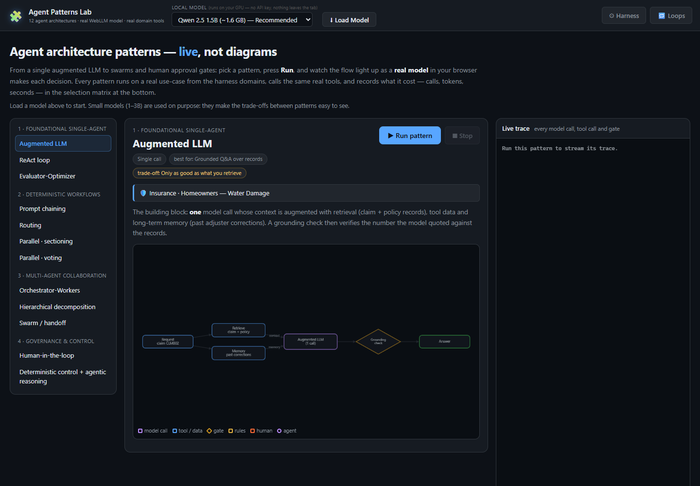

---

## The problem: agent patterns are easy to draw and hard to choose

If you are building an agentic AI system, you will meet the same question again and again: *which architecture should I use?* A single prompt? A ReAct loop with tools? A team of agents with a supervisor? Each choice changes three things at once:

- **Cost.** One pattern needs one model call. Another needs eight.
- **Latency.** A loop that "thinks" for three iterations can take ten times longer than a single grounded answer.
- **Reliability.** Some patterns have a built-in place to catch a wrong answer. Others quietly pass it to the next step.

Blog posts and framework docs describe these trade-offs in words. Words are fine, but they do not tell you how a pattern behaves with *your* model. A small model that does fine in a fixed pipeline can fall apart in an open-ended loop. You only find that out by running it.

## The solution: run every pattern on the same model and measure it

The Agent Patterns Lab puts twelve patterns side by side on one model, with the same tools and the same kind of tasks. For every run you see:

1. **A live flow graph.** Nodes light up as the model, a tool, a rule or a human acts. Failed checks turn red.
2. **A live trace.** Every prompt, every model reply, every tool call and every gate decision, with timings.
3. **A result card.** The final answer and whether the checks passed.
4. **A selection matrix.** The usual guidance (control flow, best use, trade-off) next to *measured* numbers: model calls, tokens, wall time and outcome.

All the screenshots below come from one run of all twelve patterns on **Qwen 2.5 1.5B Instruct**, a small open model, running in Chrome on an ordinary laptop. Small models are used on purpose: they make the strengths and weaknesses of each pattern easy to see.

The twelve patterns fall into four groups:

| Group | Patterns |
|---|---|
| **1. Foundational single-agent** | Augmented LLM, ReAct loop, Evaluator-Optimizer |
| **2. Deterministic workflows** | Prompt chaining, Routing, Parallel sectioning, Parallel voting |
| **3. Multi-agent collaboration** | Orchestrator-Workers, Hierarchical decomposition, Swarm / handoff |
| **4. Governance and control** | Human-in-the-loop, Deterministic control + agentic reasoning |

---

## 1. Foundational single-agent patterns

### Augmented LLM: one call, grounded in your data

**What it is:** The building block of every agent. One model call, with its context *augmented* by retrieval (records), tool results and long-term memory.

**In the demo:** An insurance adjuster asks for a settlement on a water-damage claim. The pattern retrieves the claim and the policy, adds past adjuster corrections from memory, and asks the model for a decision. A **grounding check** then verifies that the dollar amount in the answer matches the records: claim amount minus deductible.

**What happened:** The model answered $22,000 − $2,500 = **$19,500**, and the grounding check passed. One model call, 324 tokens, 14 seconds.

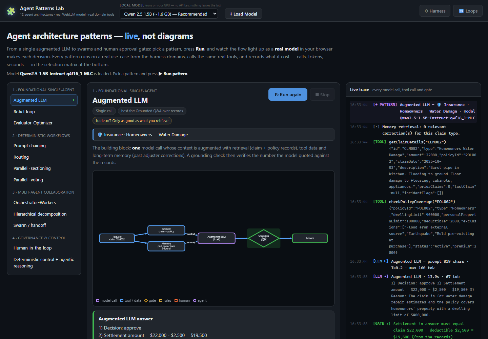

**Use it when:** you need grounded answers over records. It is the cheapest and fastest pattern, and it is only as good as what you retrieve.

### ReAct loop: thought, action, observation

**What it is:** The classic agent loop. The model thinks, picks a tool, reads the result, and repeats until it gives a final answer. An iteration cap stops runaway loops.

**In the demo:** An elderly patient on blood pressure medication asks for a cold remedy. The model has drug-interaction, vitals and dosage tools available and decides for itself which to call.

**What happened:** This is the most instructive failure in the lab. The 1.5B model tried to answer **without calling a single tool**. The harness noticed, told it which tools mattered, and asked again. The model still answered from its own knowledge, and its final answer was not valid JSON. After 3 iterations the harness stopped it and built a fallback plan marked for **manual review**. That cost 3 calls, 3,662 tokens and 136 seconds: the most expensive run in the lab, with the weakest result.

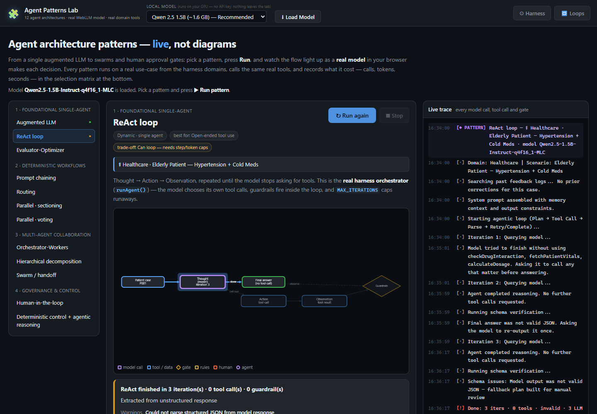

**The lesson:** ReAct gives the model the most freedom, so it needs the most capable model. With a small model, the freedom turns into wasted tokens. The step cap and the schema check are what kept this run from looping forever or shipping an unchecked answer.

### Evaluator-Optimizer: draft, critique, redraft

**What it is:** A generator writes a draft. An evaluator critiques it. The critique becomes feedback for the next draft, up to a fixed number of rounds.

**In the demo:** A marketing graduate wants to become a UX designer. The generator writes a learning plan. A **deterministic validator** checks the plan's structure and checks that every certification is a real one from the tools' data. An **LLM judge** then scores what passes.

**What happened:** The validator rejected all three drafts. The model kept inventing certifications ("Figma Certification") instead of choosing from the allowed list (Google UX Design Certificate, Nielsen Norman UX Cert, CareerFoundry UX bootcamp). After 3 rounds the lab showed the best draft, clearly marked as **not accepted**.

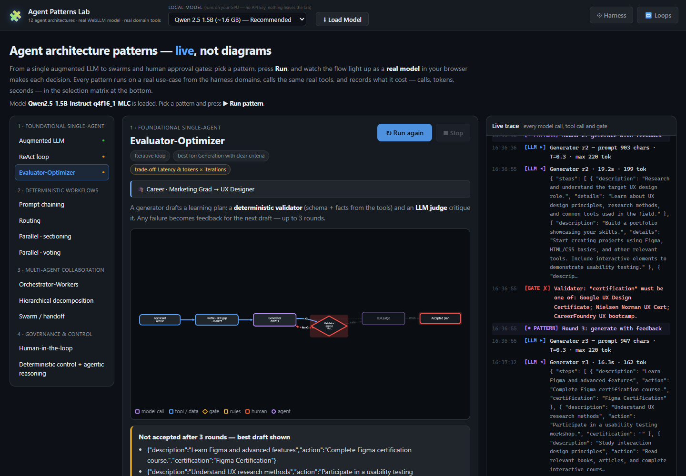

**Use it when:** you have clear, checkable criteria. Cost and latency grow with every round, so put a hard cap on the rounds. A rules-based validator in front of the LLM judge is cheap, and it catches things the judge would miss.

---

## 2. Deterministic workflow patterns

In these patterns, **code decides the flow**. The model fills in each step, but it cannot change the order of the steps.

### Prompt chaining: a fixed pipeline with gates

**What it is:** A fixed sequence of steps. Each step sees only the previous step's output. A programmatic gate checks each output before the next step runs.

**In the demo:** A drug-discovery compound with a liver-toxicity signal goes through three steps: extract safety signals, classify the risk, then write a go/no-go memo.

**What happened:** Steps 1 and 2 passed their gates. The model correctly classified the risk as HIGH. Step 3 failed twice: the memo never named the compound (QT-9901), and it never stated a clear decision. So the chain **stopped** instead of passing on a vague memo.

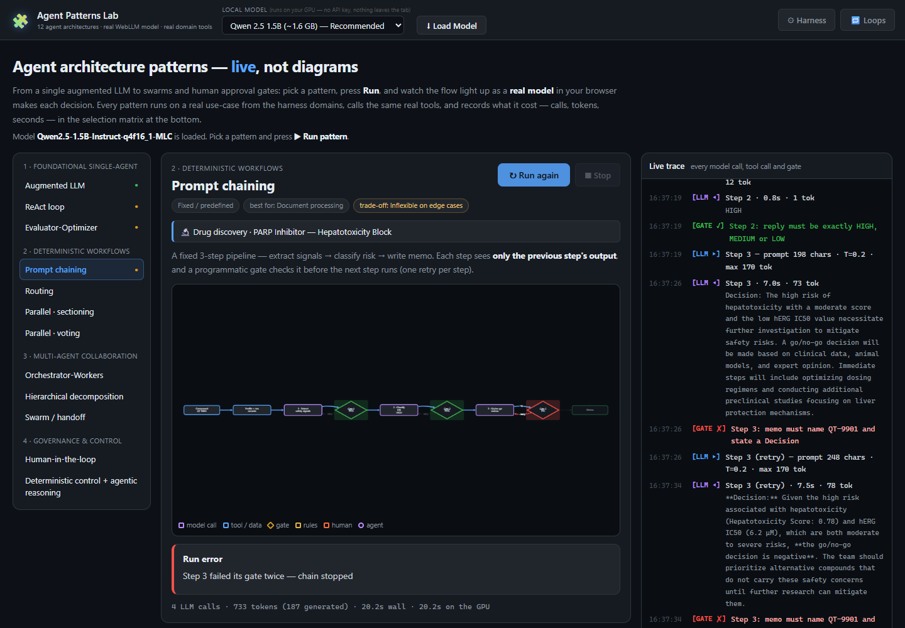

**Use it when:** the task breaks cleanly into known steps, as in document processing. A chain is predictable and easy to debug, but it does not adapt to unusual inputs. Its gates mean a bad step stops the run instead of quietly reaching the output.

### Routing: triage to one specialist

**What it is:** A router classifies the request and sends it to *one* specialist. Each specialist only gets its own domain's tools.

**In the demo:** You type a request (or pick a sample) and the model routes it to the Clinical, Claims, Career or Drug R&D specialist. If the model's answer is not a known category, the request goes to a human queue.

**What happened:** The request was *"Patient P004 is on warfarin and wants something for a tension headache. What is safe?"* The router chose **DRUG**, so the request went to the Drug Discovery specialist instead of the Clinical one. A cheap **consistency check** caught it: the request names a patient record, but it was routed to a different domain. The trace flags it as a likely misroute.

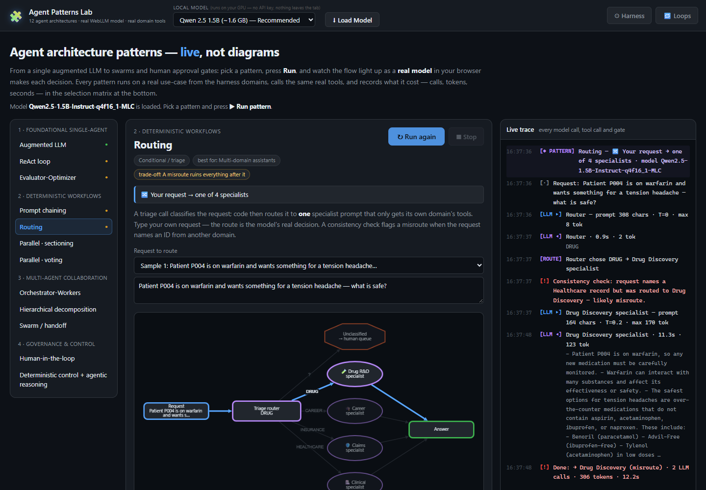

**The lesson:** In routing, everything after the router depends on the router. Here the specialist could not look up the patient record, because that tool belongs to another domain. A one-line check on record IDs costs nothing and catches this class of error.

### Parallel sectioning: split, fan out, merge

**What it is:** The task is split into independent sections. A worker handles each section at the same time, and an aggregator merges the findings.

**In the demo:** An insurance claim is split into coverage, fraud and valuation. Each analyst sees only its own slice. A final check confirms that the payout is capped at the policy limit.

**What happened:** All three analysts reported, the aggregator merged them, and the **limit check passed**. 4 calls, 26 seconds.

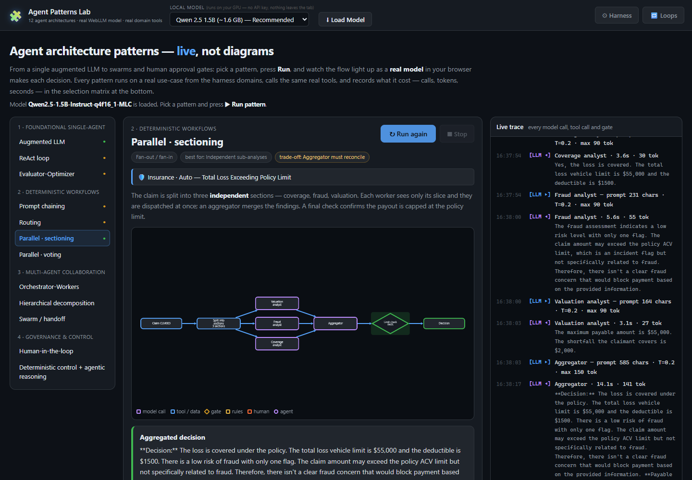

**Use it when:** sub-analyses really are independent. Each worker gets a smaller, more focused prompt, which helps small models. The hard part moves to the aggregator, which has to reconcile what the workers found.

### Parallel voting: ask several times, take the majority

**What it is:** The same question is asked several times, here at five different temperatures, and the votes are tallied.

**In the demo:** A patient on warfarin (a blood thinner) asks whether aspirin is safe. After the vote, the consensus is checked against a drug-interaction database.

**What happened:** Four voters said **UNSAFE** and one said SAFE. The consensus was UNSAFE with 80% agreement, and the interaction database confirmed it: high severity, severe bleeding risk. A single sample at the wrong temperature would have had a one-in-five chance of giving the dangerous answer.

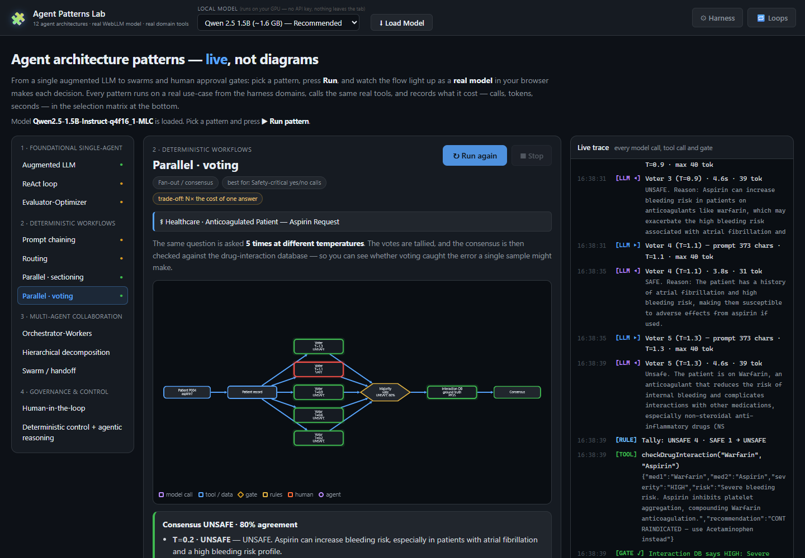

**Use it when:** the answer is a safety-critical yes or no. Voting costs N times one call, but it turns one unreliable sample into a measurable level of agreement.

---

## 3. Multi-agent collaboration patterns

### Orchestrator-Workers: plan at runtime, then delegate

**What it is:** An orchestrator model decides at runtime which specialist workers to use and what to ask each one. A synthesizer merges their findings.

**In the demo:** Prepare an IND (Investigational New Drug) readiness brief for compound DM-3350. Worker nodes appear on the graph only after the orchestrator has chosen them.

**What happened:** The orchestrator chose two workers, a **Chemist** and a **Toxicologist**. Each called the real compound and toxicology tools. The synthesizer wrote a **GO** brief that still flagged the missing reproductive-toxicity assessment. 4 calls, 34 seconds.

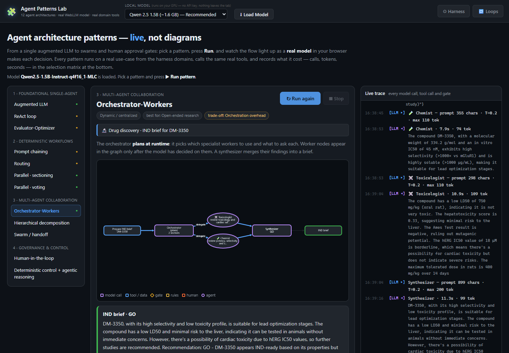

**Use it when:** you cannot know the subtasks in advance, as in open-ended research. You pay an extra call to plan and another to synthesize.

### Hierarchical decomposition: executive, managers, executors

**What it is:** Three layers. An executive sets goals, managers break the goals into tasks, executors do the tasks with real tools, and the executive makes the final call.

**In the demo:** Triage today's insurance claims queue. A risk manager and a coverage manager each assign per-claim tasks.

**What happened:** Four executors ran, two per manager. The executive referred the suspicious claim (CLM001: no police report, injuries inconsistent with a low-speed impact) to the **Special Investigations Unit**, and approved a **partial payment** on the claim near its policy limit (CLM003). This was the busiest pattern in the lab: **8 model calls** and 1,300 tokens.

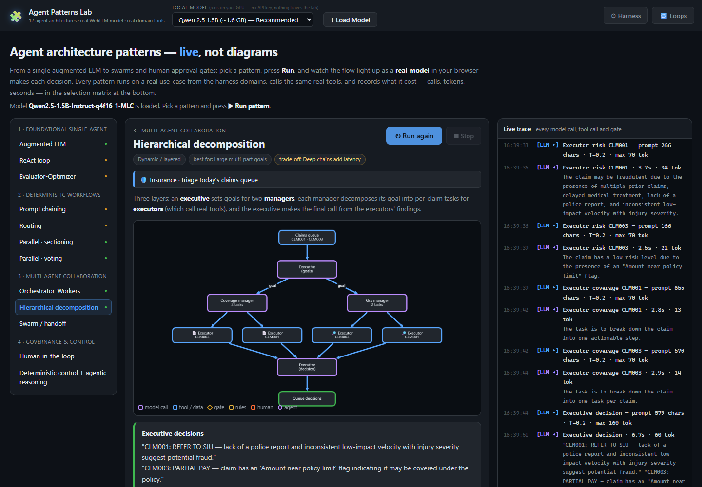

**Use it when:** the goal is large and has many parts. Each layer adds calls and latency, so keep the hierarchy shallow.

### Swarm / handoff: no supervisor

**What it is:** Agents pass the conversation to each other. Each one answers the part it owns and then decides itself who should go next. The agents share a small, validated state object: which questions are answered and which are still open.

**In the demo:** One customer message asks about an insurance claim for a chipped tooth *and* about pain relief, so it spans two departments.

**What happened:** Triage handed off to Claims, and Claims handed off to Clinical. Clinical ran real tools, including a dosage calculation and an interaction check. The run then ended with the **painkiller question still marked open**. The Claims agent had already slipped in some general pain-relief advice that it did not own.

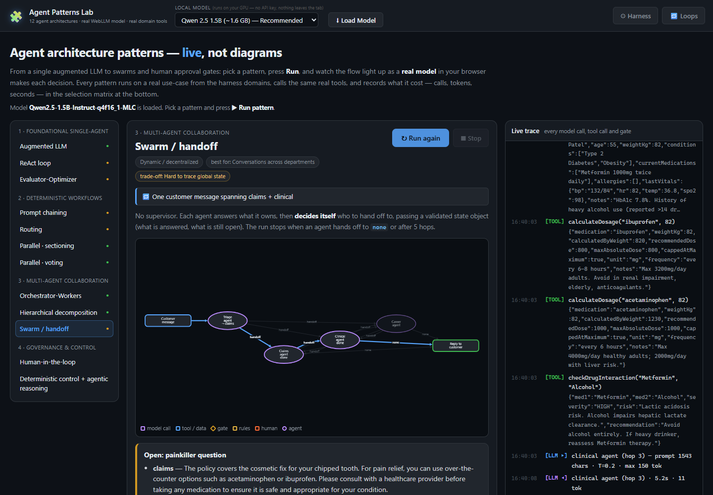

**The lesson:** A swarm is flexible and cheap here (3 calls, 15 seconds). But with no supervisor, nobody owns the whole conversation. The shared state object is what makes the gap visible, so the open question gets reported instead of disappearing.

---

## 4. Governance and control patterns

### Human-in-the-loop: pause before anything irreversible

**What it is:** The agent works on its own until it reaches a high-stakes action. Then it stops and waits for a person to approve or reject it.

**In the demo:** The agent drafts an email to a claimant whose claim has a high fraud score. A policy pre-check runs first. Then the agent pauses for your approval.

**What happened:** The pre-check flagged that the first draft **mentioned the internal fraud score to the claimant**, which no insurer should do. I rejected the draft with feedback: say the claim is on hold for review, not denied, and list the documents needed. The feedback was saved to memory, the agent redrafted, and the second draft was approved and sent.

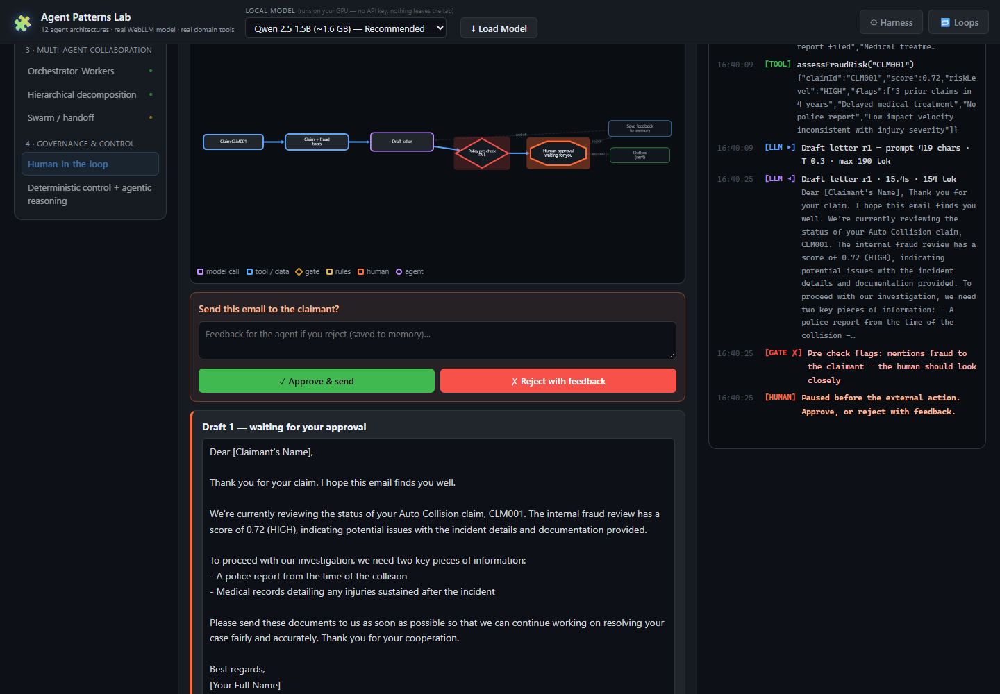

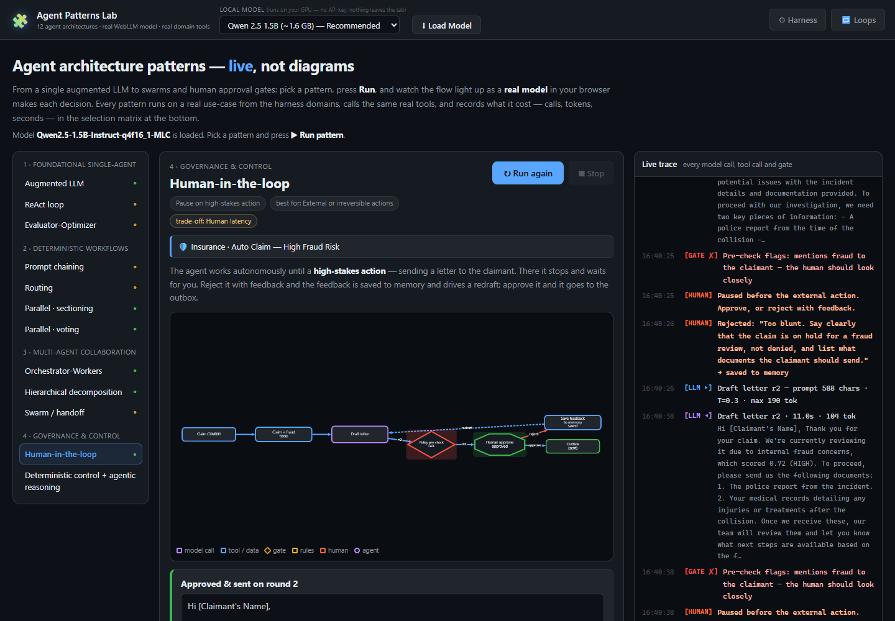

**Use it when:** an action is external or cannot be undone, such as sending a message, making a payment or filing a document. The cost is human latency. In return, a wrong action never leaves the building.

### Deterministic control + agentic reasoning: rules decide, the agent explains

**What it is:** Hard-coded rules make the pass/fail decision. The agent only *investigates*: it explains why each rule failed and suggests next steps. It can give an opinion, but it has no authority.

**In the demo:** A compliance gate for a drug candidate. Four rules check hepatotoxicity, hERG cardiac risk, reproductive toxicity and the Ames test.

**What happened:** Three rules failed, so the rules engine decided **NO-GO**. The agent's investigation was useful: it explained each failure and suggested follow-up experiments. Then it gave its own opinion: **GO**. The lab logged the override attempt and ignored it. The final decision stayed NO-GO.

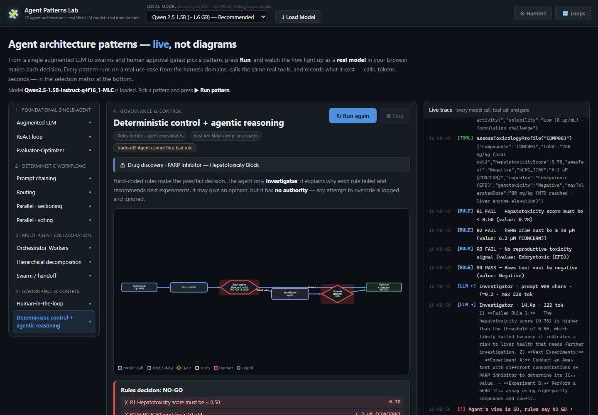

**Use it when:** you have strict compliance requirements. This is the clearest case for putting the decision in code: the model's reasoning is helpful, and its judgement is not something you want to depend on. The trade-off is that the agent cannot fix a bad rule, so the rules need owners.

---

## The selection matrix: measured, not guessed

After the runs, the selection matrix fills in with real numbers from your own model. Here is the matrix from the run above:

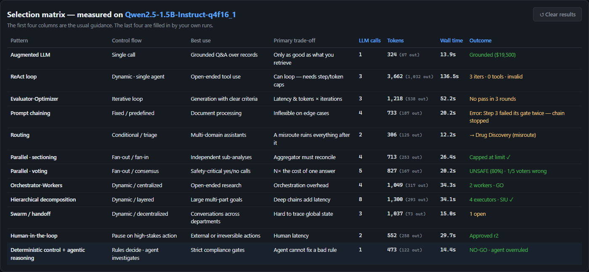

| Pattern | LLM calls | Tokens | Wall time | Outcome |
|---|---|---|---|---|
| Augmented LLM | 1 | 324 | 13.9 s | Grounded ($19,500) |
| ReAct loop | 3 | 3,662 | 136.5 s | 0 tools used, invalid output |
| Evaluator-Optimizer | 3 | 1,218 | 52.2 s | No pass in 3 rounds |
| Prompt chaining | 4 | 733 | 20.2 s | Stopped at gate 3 |
| Routing | 2 | 306 | 12.2 s | Misroute, flagged |
| Parallel sectioning | 4 | 713 | 26.4 s | Capped at limit ✓ |
| Parallel voting | 5 | 827 | 20.2 s | UNSAFE (80%) ✓ |
| Orchestrator-Workers | 4 | 1,049 | 34.3 s | 2 workers, GO |
| Hierarchical decomposition | 8 | 1,300 | 34.1 s | SIU referral ✓ |
| Swarm / handoff | 3 | 1,037 | 15.0 s | 1 question left open |
| Human-in-the-loop | 2 | 552 | 29.7 s | Approved on round 2 |
| Deterministic control | 1 | 473 | 14.4 s | NO-GO, agent overruled |

*Measured on Qwen 2.5 1.5B Instruct (q4f16) in Chrome with WebGPU on a laptop. Your numbers will differ with your model and GPU, which is the point: run it yourself.*

## What the numbers say

**1. Structure beats freedom on small models.** The patterns where code controls the flow (chaining, sectioning, voting, deterministic control) produced checkable results at low cost. The pattern with the most freedom, ReAct, was the most expensive and produced the least.

**2. Cost is not the same as value.** ReAct used 11 times the tokens of the Augmented LLM and got a worse result. Hierarchical decomposition used 8 calls and got the right answer. Measure both.

**3. Every pattern needs a checkpoint.** In this run, the model was wrong or incomplete in six of the twelve patterns. In each case a gate, a validator, a consistency check, a shared state object or a human made the problem visible. None of the six slipped through silently. The pattern decides *where* the checkpoint can go. You still have to put it there.

**4. Keep decisions in code when the stakes are high.** In the compliance gate, the agent reasoned well and still reached the wrong conclusion. Letting rules decide and the model explain gives you the best of both.

## How to choose an AI agent architecture

A practical rule of thumb from these runs:

- **Start with an Augmented LLM.** Many "agent" problems are really retrieval problems.
- **If the steps are known, use a workflow** (chaining, routing, sectioning). It is cheaper, faster and easier to debug than an agent.
- **If one answer is too risky, use voting** or an evaluator. Pay for more samples instead of trusting one.
- **Use a dynamic agent (ReAct, orchestrator, swarm) only when you cannot know the steps in advance,** and give it a capable model, a step cap and a schema check.
- **Add a human or a rules engine** in front of anything that cannot be undone or that a regulator will ask about.

## Frequently asked questions

**What are AI agent design patterns?**
They are reusable ways to arrange model calls, tools, rules and people to complete a task. Examples include ReAct, prompt chaining, routing, orchestrator-workers and human-in-the-loop.

**What is the difference between an AI workflow and an AI agent?**
In a workflow, code decides the order of the steps and the model fills them in. In an agent, the model decides what to do next. Workflows are more predictable. Agents handle tasks where the steps are not known in advance.

**Which agent pattern is best for small or local LLMs?**
In this lab, the structured patterns did best on a 1.5B model: Augmented LLM, prompt chaining, parallel sectioning, voting and deterministic control. Open-ended loops like ReAct need a stronger model.

**Does this need an API key or a GPU server?**
No. The model runs in your browser through [WebLLM](https://github.com/mlc-ai/web-llm) and WebGPU. It downloads once (about 1.6 GB for the default model) and is cached after that. You need a recent desktop Chrome or Edge.

**Can I try my own request?**
Yes. The Routing pattern has a text box, so you can type any request and see where the model sends it.

## Credits

- **Pattern taxonomy:** The workflow and agent patterns follow the widely used grouping from Anthropic's [Building Effective Agents](https://www.anthropic.com/engineering/building-effective-agents), plus the ReAct loop from Yao et al., *ReAct: Synergizing Reasoning and Acting in Language Models* (2022).
- **Running models in the browser:** [WebLLM](https://github.com/mlc-ai/web-llm) by the MLC AI team, with Qwen 2.5 and Llama 3.2 models.
- **Flow graph:** adapted from [layaForWorkflows](https://github.com/vishalmysore/layaForWorkflows).

## Disclaimer

This project is an educational demonstration and is provided as is, with no warranty of any kind.

- **Fictional data.** Every patient, claim, policy, applicant, compound, score and threshold is made up for illustration.
- **Not professional advice.** Nothing in the demo, its screenshots or this article is medical, pharmaceutical, insurance, financial, legal, career or regulatory advice.
- **AI output can be wrong.** The screenshots show a small language model's real output, including its mistakes. The checks shown are simplified examples and do not catch every error.
- **Independent work.** Names of companies, frameworks and models are used only to credit or describe them, and do not imply endorsement or affiliation.

## Try it and read further

- **Agent Patterns Lab (this article):** [vishalmysore.github.io/harnessEngineeringDemo/patterns.html](https://vishalmysore.github.io/harnessEngineeringDemo/patterns.html)
- **Harness engineering walkthrough:** the same domains with tools, guardrails, human review and memory. [Live demo](https://vishalmysore.github.io/harnessEngineeringDemo/)
- **Loop engineering:** twelve techniques for keeping the agent loop reliable. [Read the article](https://github.com/vishalmysore/harnessEngineeringDemo/blob/main/article_loop_engineering.md)
- **Source code:** [github.com/vishalmysore/harnessEngineeringDemo](https://github.com/vishalmysore/harnessEngineeringDemo)

The pattern you pick decides how many calls you pay for and where mistakes can be caught. Do not pick from a diagram. Run your own model through each pattern, read the trace, and let the measurements decide.
