# Harness Engineering for AI Agents: A Hands-On Walkthrough in Your Browser

Most people judge an AI agent by the model inside it. Swap in a bigger model, get a better agent. That is only half the story. The other half is everything wrapped around the model: what it is allowed to look up, which actions get stopped before they happen, who signs off on the result, and what the system remembers the next time. That wrapper is called the **harness**, and designing it well is what people now call **harness engineering**.

It is easy to agree with that idea in the abstract and much harder to picture it. So I built a small demo that you can open in a browser tab and click through. No account, no API key, no server. This article walks through it screen by screen.

**Try it yourself:** [vishalmysore.github.io/harnessEngineeringDemo](https://vishalmysore.github.io/harnessEngineeringDemo/)

---

## The problem: a good model is not a safe agent

Imagine asking an assistant to recommend a cold remedy for a 75-year-old on blood pressure medication. A capable language model will produce a fluent, confident answer. It may also recommend pseudoephedrine, which raises blood pressure, and ibuprofen, which is hard on kidneys that are already struggling. Nothing in the model itself guarantees it checked.

The same pattern shows up everywhere an agent makes a decision that matters:

- An insurance assistant approves a claim that a fraud score should have stopped.
- A drug discovery assistant advances a compound with a liver-toxicity signal.
- A career assistant gives advice that quietly depends on someone's age.

You do not fix these by writing a longer prompt. You fix them by building checks *around* the model that run every time, whatever the model says.

## The solution: three layers around the model

The demo organises the harness into three layers. The names are plain on purpose:

| Layer | What it does | In the demo |
|-------|--------------|-------------|
| **1. Information** | Decides what the model knows before it starts | Looks up past human corrections, assembles the prompt, describes the available tools |
| **2. Execution** | Runs the loop and enforces the rules | Calls tools, checks every result against guardrails, stops unsafe actions, retries when needed |
| **3. Feedback** | Checks the output and learns from people | Validates the output format, asks a human to approve or correct, saves corrections to memory |

The model sits in the middle. It plans, asks for tools and writes the recommendation. The harness decides what happens to every one of those steps.

---

## A tour of the interface

When you open the page, you see three columns: the case on the left, a live trace of the agent in the middle, and a review desk on the right.

The left column picks a **domain** (healthcare, insurance, career counselling or drug discovery) and a **scenario** within it. Each scenario is a realistic case with a short description and tags. Below that, three coloured cards remind you which layer is which. The same colours are used in the trace, so you can always tell which layer is speaking.

Across the top is the model loader:

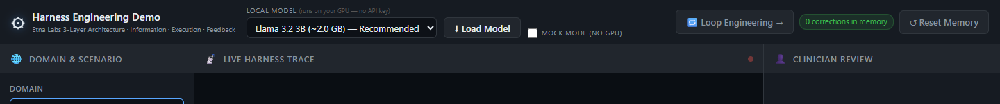

There are two ways to run the agent:

1. **Load a real model.** Pick one of the small open models (Llama 3.2, Phi-3.5, Qwen 2.5 or Gemma 2) and it downloads once, then runs on your own graphics card through WebGPU. Nothing you type leaves your computer.
2. **Mock mode.** No download and no GPU needed. The model's text is replaced by a scripted answer, but the tools, guardrails, verification and memory are the same code that runs in real mode. It is the fastest way to see how the harness behaves.

On the right of the bar is a counter of how many human corrections are stored in memory, a reset button, and a link to the companion [Loop Engineering page](./article_loop_engineering.md).

---

## Walkthrough 1: a child with a penicillin allergy

Let's start with the case that shows the whole harness in one run. An 8-year-old has confirmed strep throat. The parent is asking for amoxicillin. The chart says the child had anaphylaxis to penicillin.

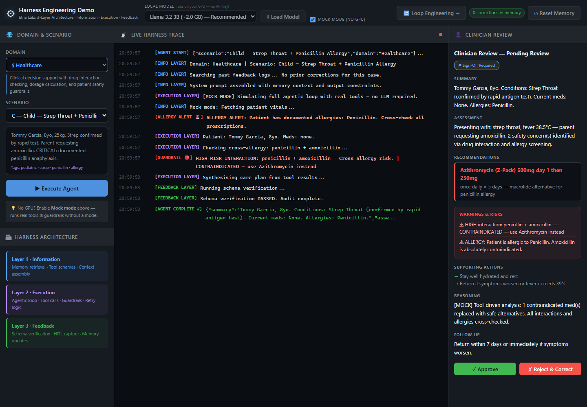

Here is the trace on its own, so you can read it top to bottom:

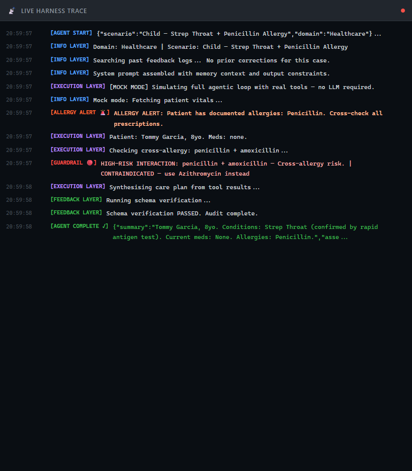

Reading it line by line:

- **Information layer (blue).** The harness searches past corrections, finds none for this case, and builds the prompt.
- **Execution layer (purple).** The agent fetches the patient's record. The moment the record comes back, a guardrail fires an **allergy alert**: penicillin is listed, so every prescription must be cross-checked.
- **Guardrail (red).** The agent checks penicillin against amoxicillin and the guardrail flags a **high-risk cross-allergy**. This is not the model's opinion. It is a rule in code that runs on every tool result.
- **Feedback layer (green).** The final answer is checked against the required format before anyone sees it.

The result lands on the clinician's desk:

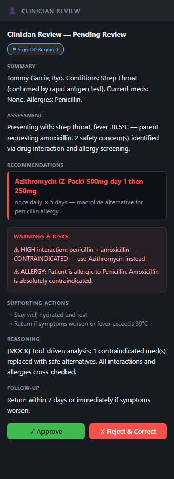

The recommendation is azithromycin, the usual alternative for penicillin-allergic patients, and the warnings explain why amoxicillin was ruled out. Note the **Sign-Off Required** badge. Nothing is final until a person approves it.

## Walkthrough 2: the agent learns from a correction

Suppose the clinician wants the advice to go further. They click **Reject & Correct** and type what the agent should have said:

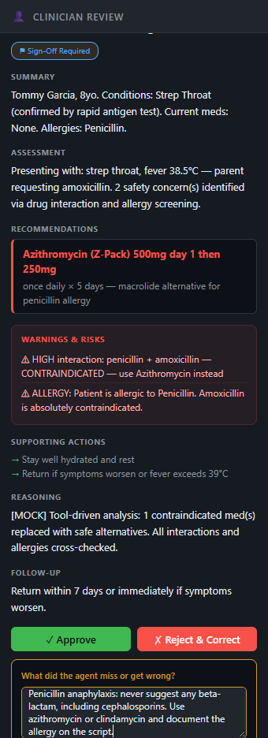

When they submit, the correction is saved to memory. The counter at the top changes to **1 correction in memory** and the trace confirms it:

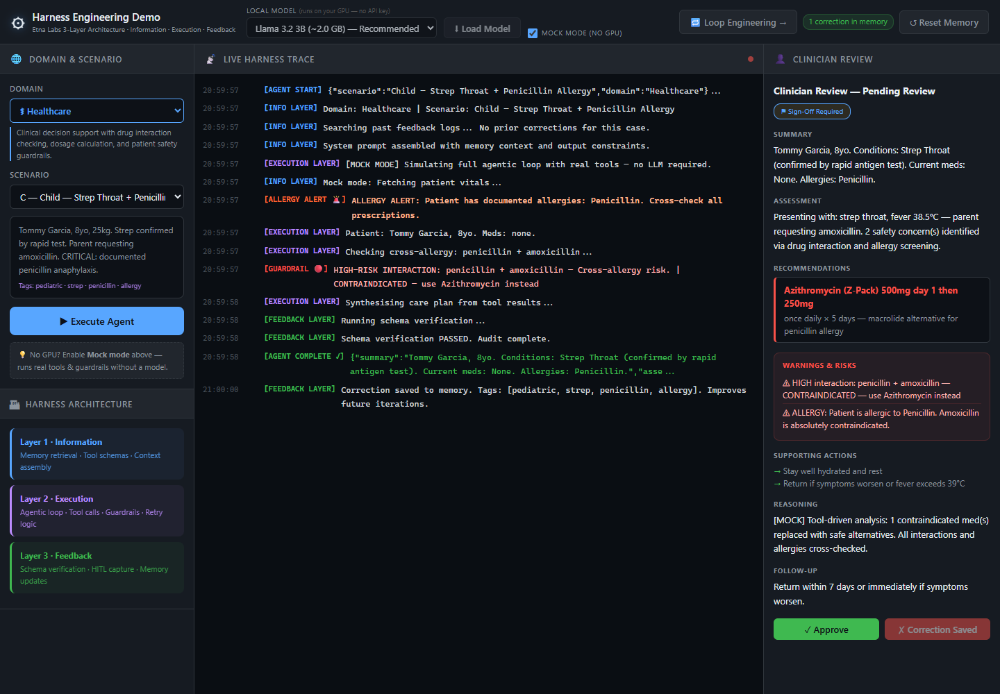

Now run the same case again. Look at the third line of the trace:

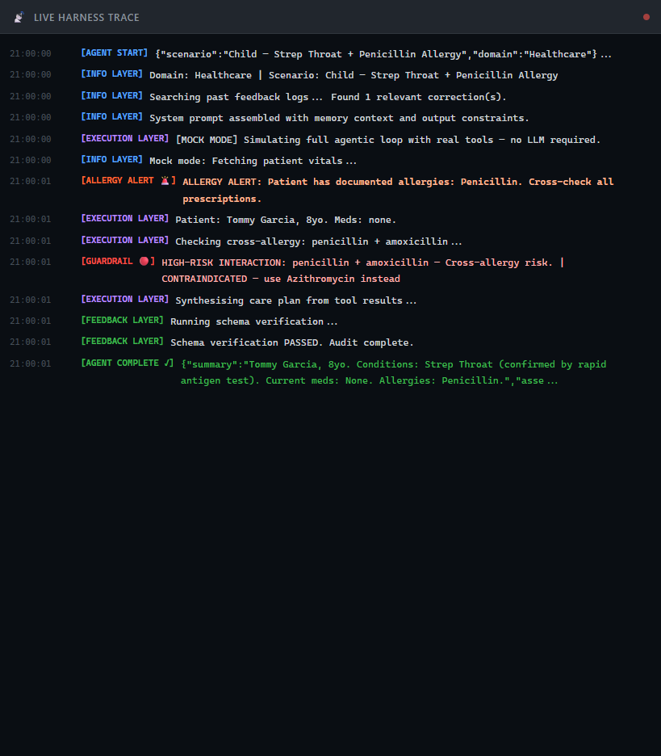

*"Found 1 relevant correction(s)."* The harness pulled the clinician's note out of memory and placed it in the prompt before the model started. Nobody retrained anything. The agent simply starts the next similar case knowing what a human told it last time.

Memory is kept per domain. A healthcare correction about antibiotics will never appear in an insurance claim or a career plan, even if a few words happen to overlap.

## Walkthrough 3: a dangerous drug combination

A 62-year-old on warfarin, a blood thinner, asks for aspirin for a headache.

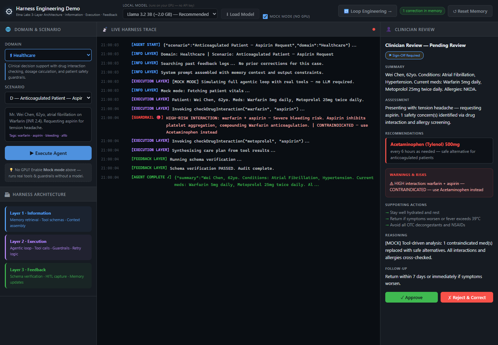

The agent checks warfarin against aspirin and the guardrail stops it: the two together sharply raise the risk of bleeding. It also checks the patient's other medication, metoprolol, against aspirin. The final recommendation switches to acetaminophen and says why. Every interaction check is visible in the trace, so a reviewer can see exactly what was checked, not just the conclusion.

---

## The same harness, four different jobs

The loop in the middle is the same for every domain. Only the tools, the rules and the reviewer change. That is the point of harness engineering: you build the structure once, then plug in each domain's knowledge.

### Insurance: a suspicious car claim

An $8,500 rear-end collision claim. The claimant has three previous claims, there is no police report, and medical treatment began ten days after the accident.

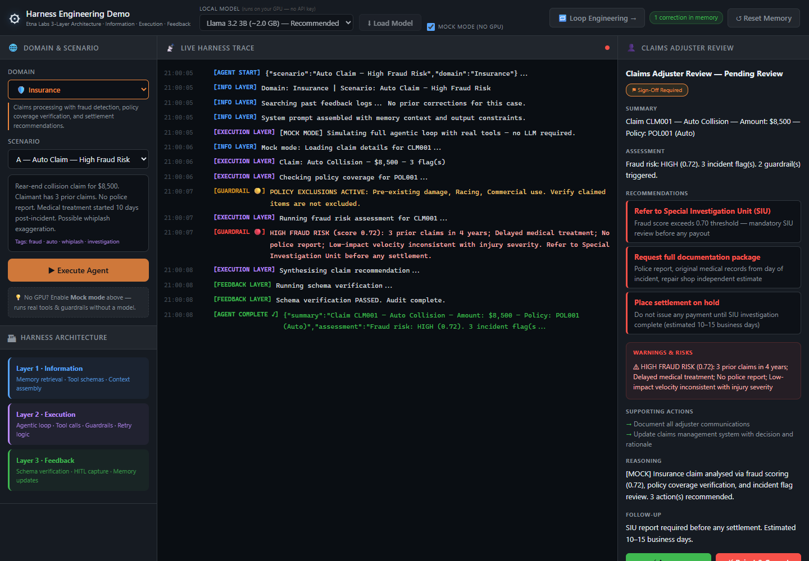

Two guardrails fire. The first reminds the agent which exclusions apply to the policy. The second is the important one: the fraud score is 0.72, above the 0.70 threshold, so the claim **must** go to the Special Investigation Unit before any money is paid. The agent recommends exactly that, plus a documentation request and a hold on the settlement. The claims adjuster still has the final say.

A second insurance case shows a softer guardrail. A totalled car is worth $67,000, but the policy limit is $55,000:

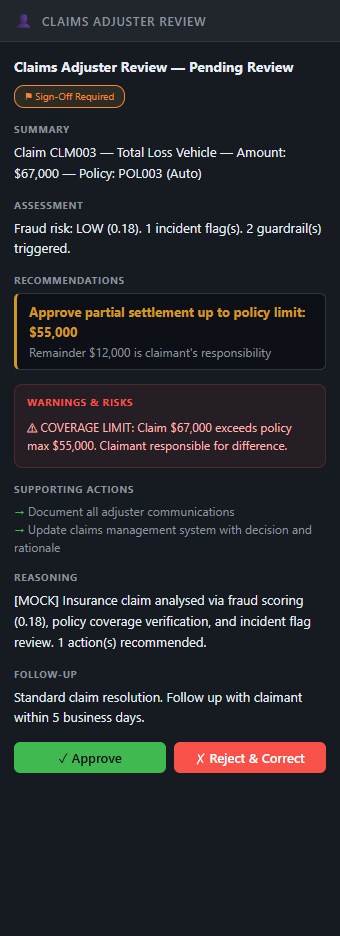

The harness does not block the claim. It caps the recommendation at the policy limit and states clearly that the remaining $12,000 is the claimant's responsibility. Some rules stop the agent; others shape its answer.

### Career counselling: retraining after a layoff

A 41-year-old assembly line technician with 18 years of precision manufacturing experience has been laid off and wants to move into CNC machining.

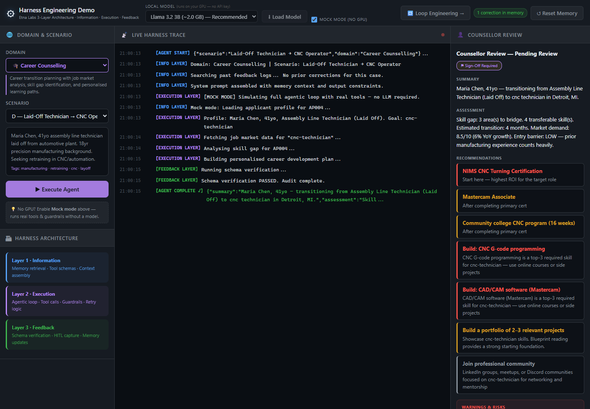

The agent loads the applicant's profile, pulls job market data for CNC technicians, and runs a skill-gap analysis. The plan that comes back is concrete: a starting certification, a community college programme, the two skills that matter most for the role, and an estimated four months to transition. The career domain also carries fairness rules. For applicants over 50 the harness adds a note telling the agent to stay age-neutral and skills-focused, and a final check rejects any plan that promises a specific salary. A good harness enforces rules about *how* a decision is made, not only *what* it says.

### Drug discovery: a compound with a liver-toxicity signal

A PARP inhibitor for ovarian cancer is very potent, but it scores 0.78 on hepatotoxicity and shows a cardiac safety concern.

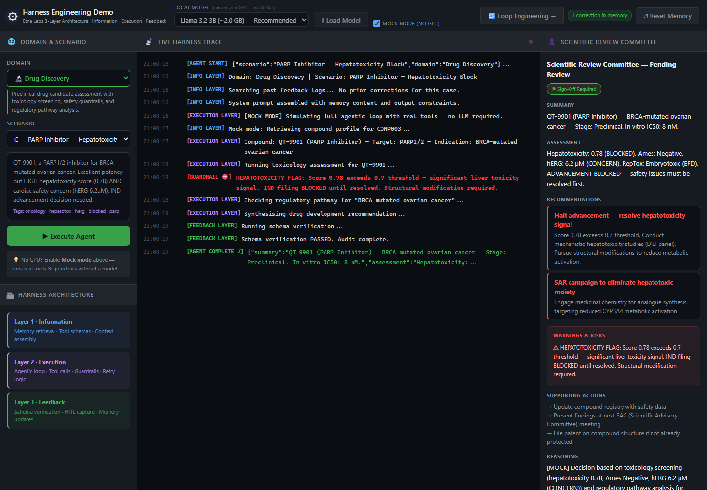

The toxicology tool returns the score, and the guardrail compares it to a 0.70 threshold. It is over, so **filing to start human trials is blocked** until the problem is resolved. The agent's recommendation follows the rule: stop advancement, run liver-safety studies, and start a chemistry programme to remove the part of the molecule causing the problem.

The scientific review committee approves the plan:

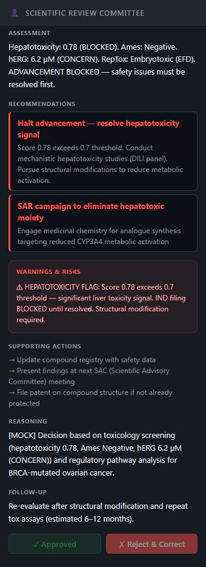

---

## Running it on a real local model

Mock mode is great for seeing the harness, but the real test is putting an actual language model inside it. Click **Load Model** and the model downloads once, is cached by the browser, and runs on your GPU.

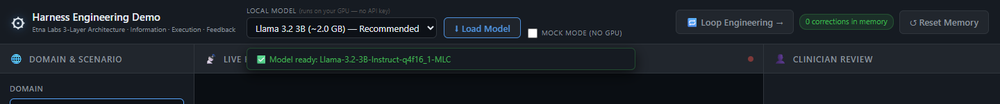

I tested this on an ordinary laptop with an Intel integrated GPU, which is about the hardest place to run a language model. The results are worth sharing as they happened, because they show why the harness exists.

**When the model behaves.** On its first pass through the penicillin case, Llama 3.2 3B did exactly what you want. It fetched the patient record, the allergy alert fired, it checked amoxicillin against penicillin, and the cross-allergy guardrail stepped in with "contraindicated, use azithromycin instead." That is the same chain of events as the walkthrough above, driven by a real model running on the laptop.

**When the model does not.** Small models wander. In later iterations the same model kept repeating its tool calls with the arguments left empty. The harness now refuses those calls before they run and tells the model which argument is missing, so the model gets a clear signal instead of a vague error.

On another run the model produced pure noise. This happens with some half-precision model builds on integrated graphics: the numbers overflow and the text comes out scrambled.

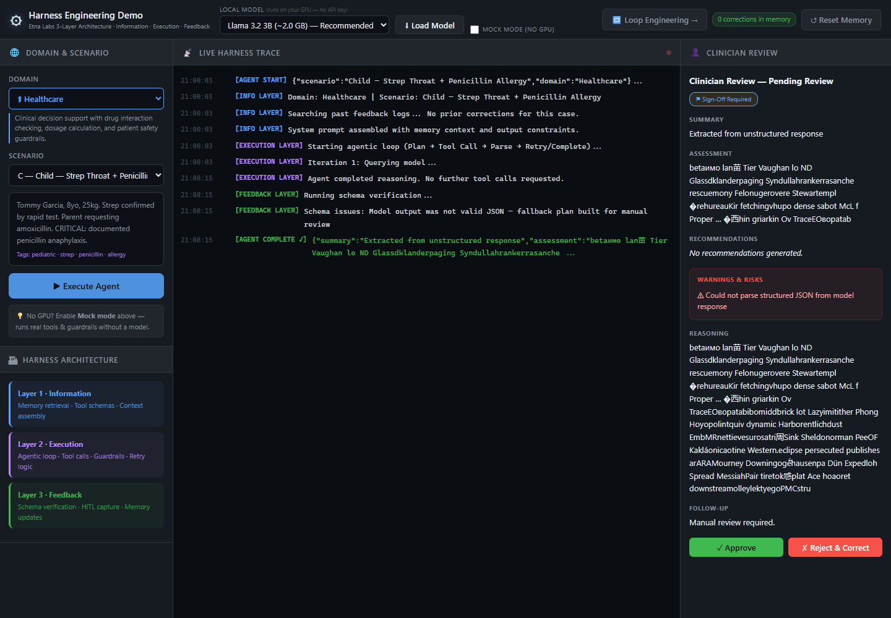

Look at what the harness did with it. The Feedback layer reported that the output was not valid JSON. No recommendation was produced, a clear warning was raised, and the case went to the clinician marked **Manual review required**. Nothing unsafe reached the review desk looking like a real answer.

That is the honest lesson of running agents on small local models: the model will sometimes fail, and the harness is what turns a silent failure into a visible one. On a stronger GPU, or with the larger models in the list, runs are faster and far more reliable. The safety behaviour stays the same either way, because it lives in the harness, not in the model.

---

## Why this matters

**For teams building agents.** Most of the safety in this demo has nothing to do with the model. The allergy check, the fraud threshold, the toxicity block and the format check are ordinary code. They are easy to test, easy to audit and they behave the same way every time. When you upgrade the model, they keep working.

**For people reviewing AI decisions.** The live trace turns the agent from a black box into a list of steps. A clinician or claims adjuster can see which tools ran, which rules fired, and why the recommendation changed, before they sign off.

**For organisations worried about data.** Everything runs in the browser tab. Patient details, claim notes and corrections never leave the computer. For regulated industries that is often the difference between "interesting demo" and "something we can actually pilot".

**For anyone learning about agents.** Because the same loop serves four very different domains, you can see clearly which parts of an agent are general (the loop, the trace, the memory, the review step) and which parts are specific (the tools and the rules).

## Frequently asked questions

**What is harness engineering?**
Harness engineering is the practice of designing the system around an AI model: the tools it can use, the rules that check its actions, the memory it draws on, and the human review it passes through. The model provides the reasoning; the harness makes the result reliable.

**How is it different from prompt engineering?**
Prompt engineering changes what you *ask* the model. Harness engineering changes what *happens* to the model's answer. A prompt can ask the model to check for allergies; a harness checks for allergies whether the model remembered to or not.

**Do I need a GPU or an API key to try the demo?**
No. Mock mode runs the full harness without any model. To run a real model you need a browser with WebGPU, such as a recent Chrome or Edge. No API key is ever required.

**Does the agent really learn from corrections?**
It remembers them. A correction is stored and pulled into the prompt the next time a similar case comes up in the same domain. The model's weights do not change, which is exactly why this is safe and easy to undo: click **Reset Memory** and it is gone.

**Is this medical, insurance or financial advice?**
No. All patients, claims, applicants and compounds are fictional, and the rules are simplified for illustration. The demo shows how a harness is structured, not how to treat anyone.

## Try it and read further

- **Live demo:** [vishalmysore.github.io/harnessEngineeringDemo](https://vishalmysore.github.io/harnessEngineeringDemo/)
- **Loop engineering, the companion page:** twelve techniques for keeping the agent loop reliable, each run on the same harness. [Read the article](./article_loop_engineering.md)
- **The concepts in depth:** [Harness Engineering: The Infrastructure Layer That Makes AI Agents Actually Work](./article.md)
- **How we got here:** [From Prompt Engineering to Harness Engineering](./article2.md)
- **Source code:** [github.com/vishalmysore/harnessEngineeringDemo](https://github.com/vishalmysore/harnessEngineeringDemo)

The model is the brain. The harness is the hands. Better models will keep arriving, but the hands are what decide whether the brain does something useful or something harmful.
