# Harness Engineering for AI Agents: A Real-Model Walkthrough in Your Browser

Most people judge an AI agent by the model inside it. Swap in a bigger model, get a better agent. That is only half the story. The other half is everything wrapped around the model: what it is allowed to look up, which actions get stopped before they happen, who signs off on the result, and what the system remembers next time. That wrapper is called the **harness**, and designing it well is what people now call **harness engineering**.

It is easy to agree with that idea in the abstract and much harder to picture it. So I built a demo that runs in a browser tab: a real language model, real tools, real guardrails, and a human review desk. No account, no API key, no server. Every screenshot in this article comes from a real model running on an ordinary laptop. No scripted answers.

**Try it yourself:** [vishalmysore.github.io/harnessEngineeringDemo](https://vishalmysore.github.io/harnessEngineeringDemo/)

---

## The problem: a good model is not a safe agent

Imagine asking an assistant to recommend a cold remedy for a 75-year-old on blood pressure medication. A capable language model will produce a fluent, confident answer. It may also recommend pseudoephedrine, which raises blood pressure, and ibuprofen, which is hard on kidneys that are already struggling. Nothing in the model itself guarantees it checked.

The same pattern shows up everywhere an agent makes a decision that matters:

- An insurance assistant approves a claim that a fraud score should have stopped.
- A drug discovery assistant advances a compound with a liver-toxicity signal.
- A career assistant gives advice that quietly depends on someone's age.

You do not fix these by writing a longer prompt. You fix them by building checks *around* the model that run every time, whatever the model says. As you will see below, that matters even more with small models, which make mistakes often.

## The solution: three layers around the model

The demo organises the harness into three layers:

| Layer | What it does | In the demo |
|-------|--------------|-------------|
| **1. Information** | Decides what the model knows before it starts | Looks up past human corrections, assembles the prompt, describes the available tools |
| **2. Execution** | Runs the loop and enforces the rules | Calls tools, checks every result against guardrails, stops unsafe actions, keeps the loop on track |
| **3. Feedback** | Checks the output and learns from people | Validates the answer, checks it against domain rules, asks a human to approve or correct, saves corrections to memory |

The model sits in the middle. It plans, asks for tools and writes the recommendation. The harness decides what happens to every one of those steps.

---

## A tour of the interface

The page has three columns: the case on the left, a live trace of the agent in the middle, and a review desk on the right.

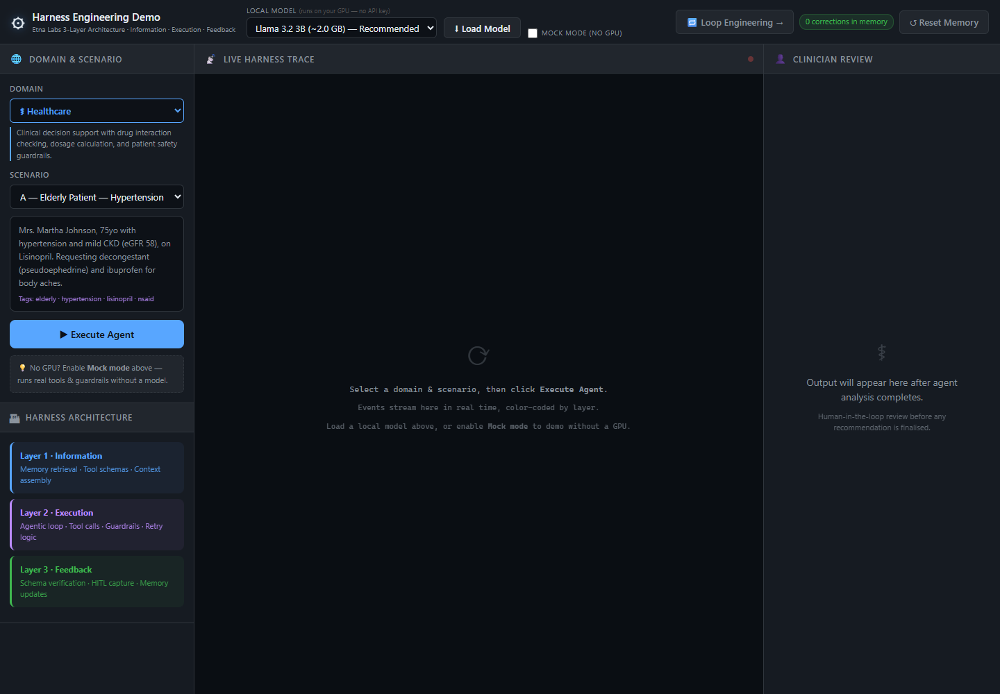

The left column picks a **domain** (healthcare, insurance, career counselling or drug discovery) and a **scenario** within it. Below that, three coloured cards name the layers. The same colours are used in the trace, so you can always tell which layer is speaking.

Across the top is the model loader. For this article I used **Llama 3.2 3B**, a small open model, in its full-precision (f32) build:

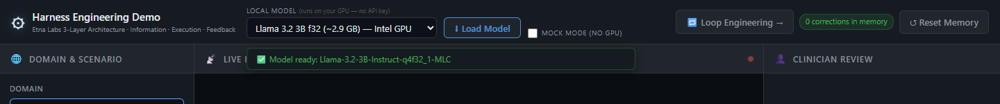

The model downloads once (about 2.9 GB), is cached by the browser, and runs on your graphics card through WebGPU. Nothing you type leaves your computer. I ran everything on a laptop with Intel integrated graphics, about the hardest place to run a language model, so each case took between 6 and 18 minutes. A dedicated GPU is much faster.

There is also a **Mock mode** checkbox. It swaps the model's text for a scripted answer but keeps the real tools, guardrails and memory, so you can see the harness work in seconds without a download.

---

## Walkthrough 1: a child with a penicillin allergy

An 8-year-old has confirmed strep throat. The parent is asking for amoxicillin. The chart says the child had anaphylaxis to penicillin.

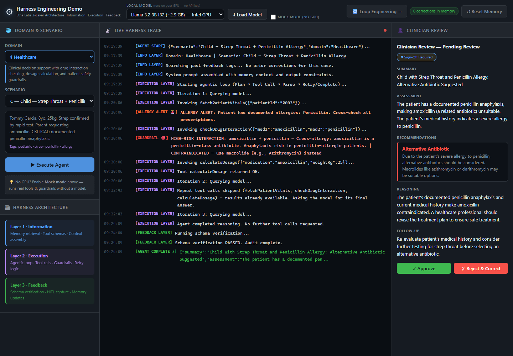

Here is the trace on its own:

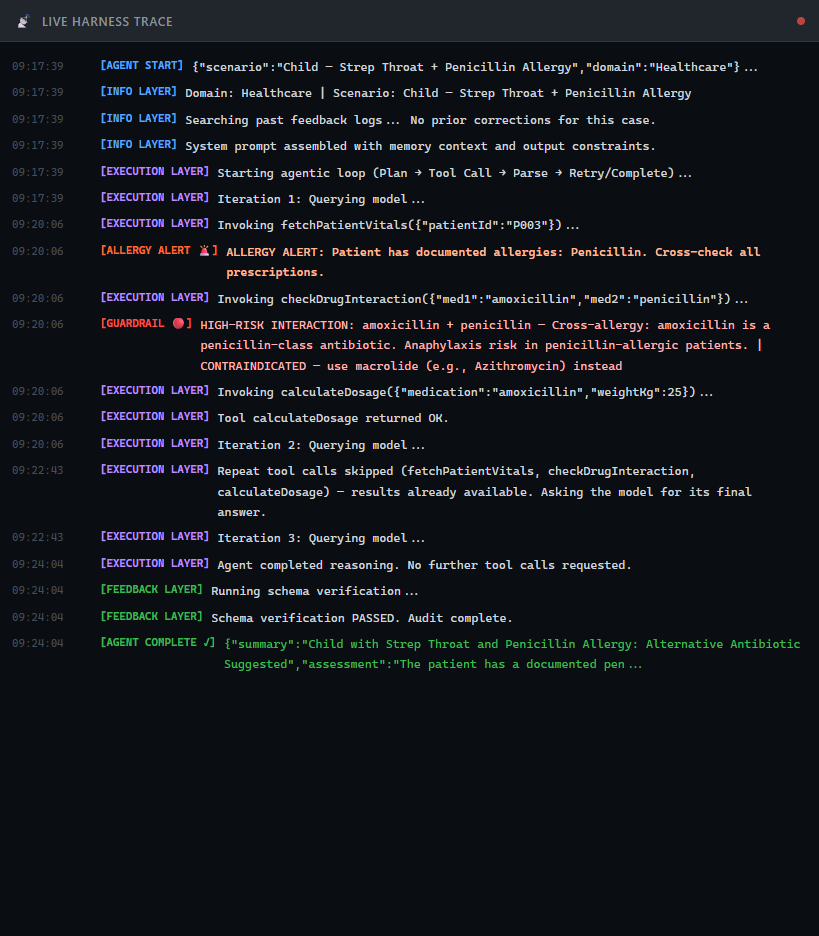

Reading it top to bottom:

- **Information layer (blue).** The harness searches past corrections, finds none, and builds the prompt.
- **Execution layer (purple).** The model asks for the patient's record. When it comes back, a guardrail raises an **allergy alert**.
- **Guardrail (red).** The model checks amoxicillin against penicillin, and the guardrail flags a **high-risk cross-allergy** and points to azithromycin. This is a rule in code, not the model's opinion, and it runs on every tool result.
- **Execution layer, again.** On its next turn the model asks for the same three tools all over again. Small models do this a lot. The harness notices it already has those results, skips the calls, and tells the model to write its answer.
- **Feedback layer (green).** The answer is checked before anyone sees it.

The recommendation lands on the clinician's desk:

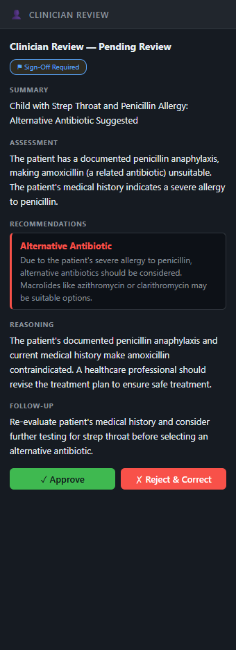

Amoxicillin is ruled out, and the model suggests a macrolide such as azithromycin or clarithromycin. The **Sign-Off Required** badge means nothing is final until a person approves it.

## Walkthrough 2: the agent learns from a correction

The clinician wants the advice to go further, so they click **Reject & Correct** and write what the agent should have said:

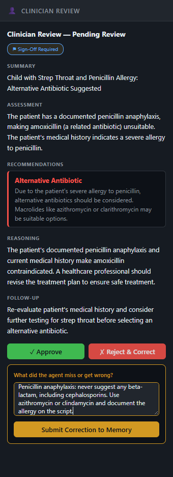

The correction is saved to memory, and the counter at the top changes to **1 correction in memory**:

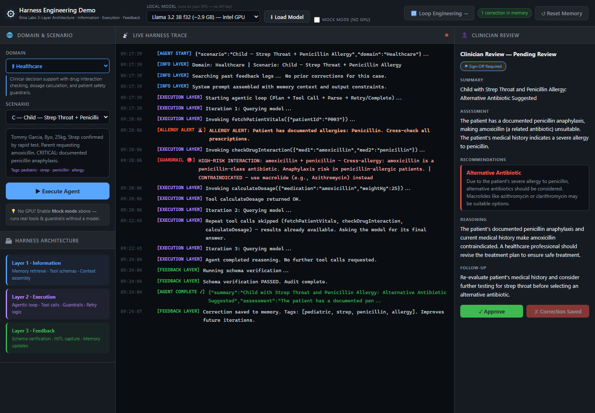

Now run the same case again:

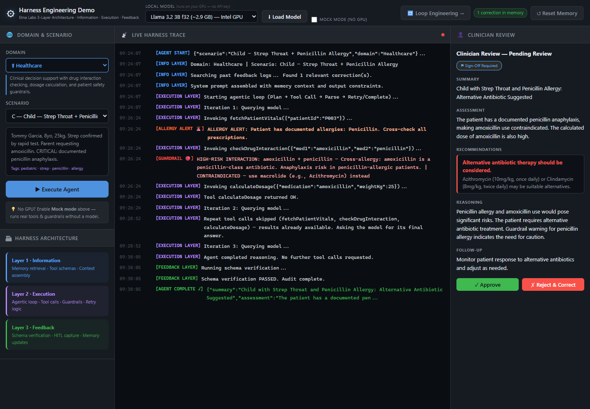

The third line now reads *"Found 1 relevant correction(s)."* The harness put the clinician's note in the prompt before the model started, and it shows in the answer. This time the model recommends **azithromycin or clindamycin**. Clindamycin came from the clinician's correction; the first run never mentioned it. Nobody retrained anything.

Memory is kept per domain, so a healthcare note about antibiotics never leaks into an insurance claim or a career plan.

## Walkthrough 3: a dangerous drug combination

A 62-year-old on warfarin, a blood thinner, asks for aspirin for a headache.

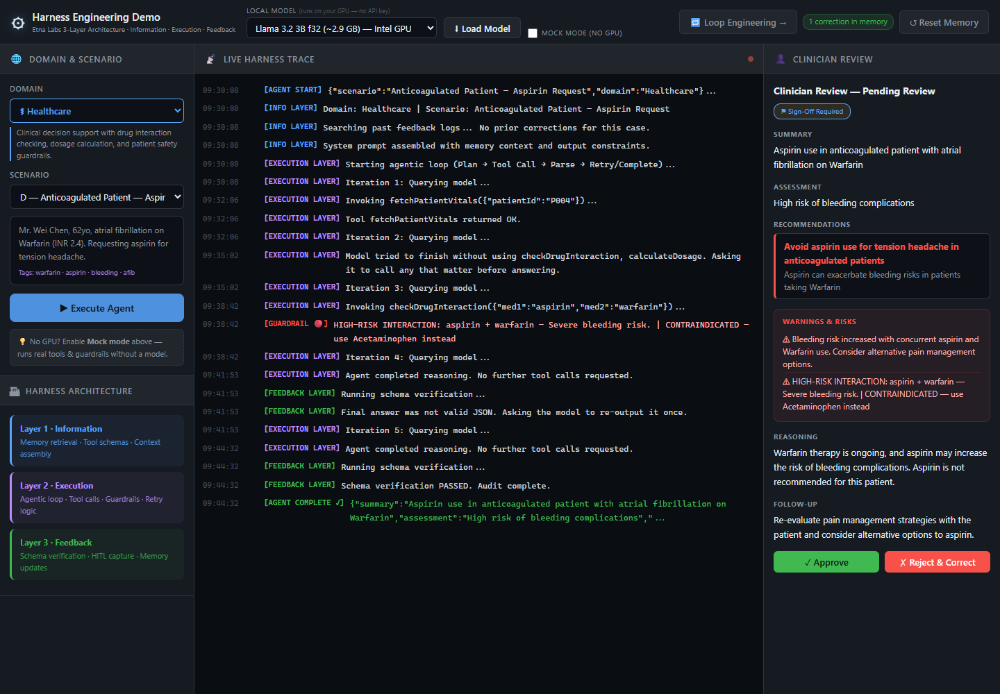

This run shows the harness keeping a small model on track twice:

1. After reading the patient record, the model tried to answer straight away, without checking any interactions. The harness saw that two tools were never used and asked the model to call any that mattered. It went back and checked warfarin against aspirin, and the guardrail flagged the bleeding risk.
2. The model's next reply was not a proper answer. The harness asked once for the answer in the required format, and the second attempt passed.

The final recommendation: avoid aspirin, because it raises the bleeding risk on warfarin, with acetaminophen named as the safer option.

---

## The same harness, four different jobs

The loop in the middle is the same for every domain. Only the tools, the rules and the reviewer change.

### Insurance: a suspicious car claim

An $8,500 rear-end collision claim. The claimant has three previous claims, there is no police report, and medical treatment started ten days after the accident.

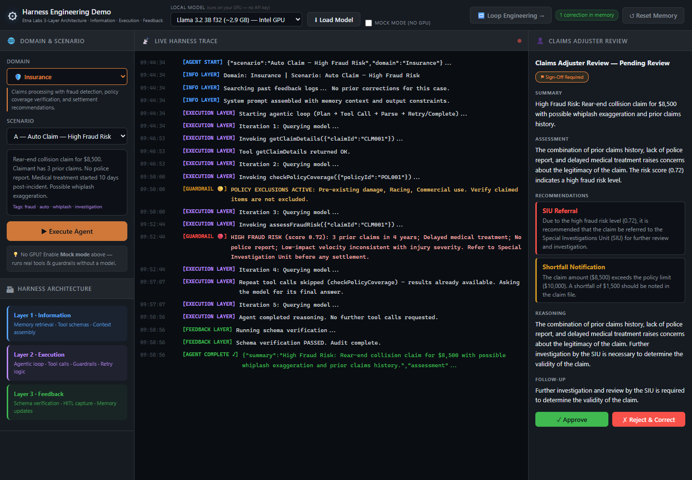

The model pulled the claim, the policy and the fraud score. The fraud score came back at 0.72, over the 0.70 threshold, so the guardrail requires a referral to the Special Investigation Unit before any payment. The model's first recommendation is exactly that.

The second recommendation shows why the review desk exists. The model wrote a "shortfall notification" claiming the $8,500 claim exceeds a $10,000 limit. That is wrong twice: $8,500 is less than $10,000, and the policy's real collision limit is $50,000. No rule in the harness checks that kind of made-up arithmetic, and that is the claims adjuster's job. A harness does not make a small model infallible. It makes sure a person sees the answer, with the evidence beside it, before anything happens.

### Insurance: a claim above the policy limit

A totalled car is worth $67,000, but the policy limit is $55,000. The fraud score is low.

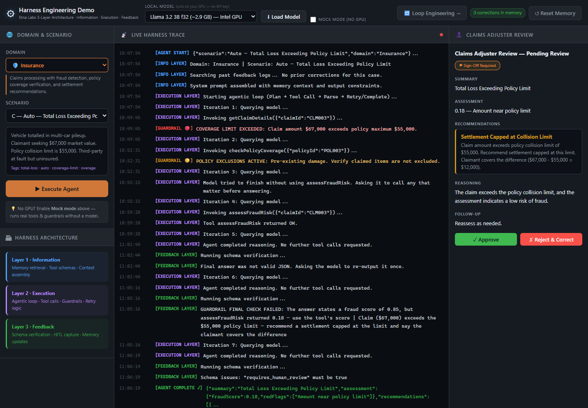

This is the most interesting run in the set. The model's first answer **invented a fraud score of 0.85** (the tool said 0.18) and ignored the policy limit. Both mistakes were caught by the insurance domain's final check, which compares the answer with the tool results:

> The answer states a fraud score of 0.85, but assessFraudRisk returned 0.18. Use the tool's score. Claim ($67,000) exceeds the $55,000 policy limit. Recommend a settlement capped at the limit and say the claimant covers the difference.

The harness sent those exact errors back, and the model fixed its answer: **settlement capped at the $55,000 collision limit, with the claimant covering the remaining $12,000.** The tool results, not the model's memory, decided the numbers.

### Career counselling: retraining after a layoff

A 41-year-old assembly line technician with 18 years of precision manufacturing experience has been laid off and wants to move into CNC machining.

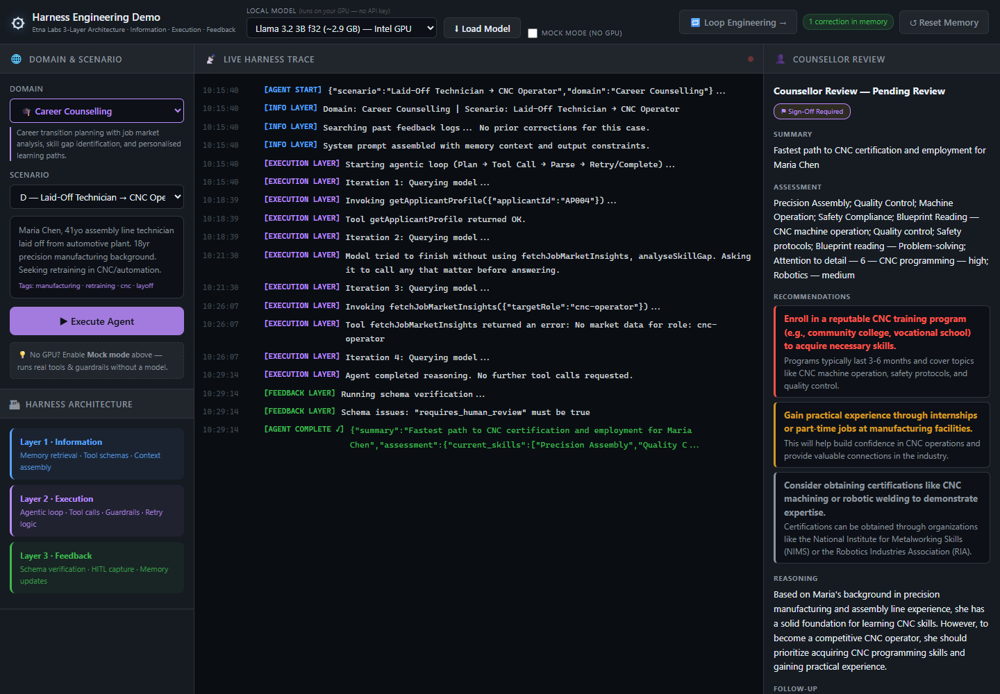

The plan is sensible: a CNC programme at a community college or vocational school, hands-on experience through internships or part-time work, and certification through bodies like NIMS. The run also shows a small model's limits. Asked to check the job market, it looked up "cnc-operator", but the data uses "cnc-technician". The tool replied with the list of valid roles, and the model answered anyway instead of trying again. The career rules also keep advice skills-focused: older applicants get an age-neutral reminder, and any plan that promises a specific salary is rejected.

### Drug discovery: a compound with a liver-toxicity signal

A PARP inhibitor for ovarian cancer is very potent, but it scores 0.78 on hepatotoxicity (liver toxicity) and shows a cardiac safety concern.

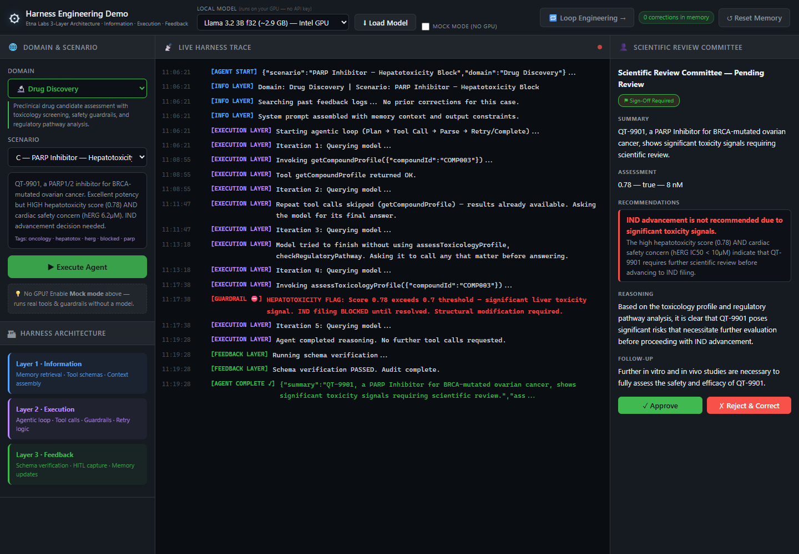

The model looked up the compound, asked for the same profile again (skipped), and then tried to answer without looking at the toxicology data. The coverage reminder sent it back to run the toxicology check. The score came back above the 0.70 threshold, and the guardrail **blocked filing to start human trials** until the problem is fixed. The model's recommendation follows the rule: IND advancement is not recommended, citing both the liver signal and the cardiac (hERG) concern.

This case also caught a bug in the harness itself. The original rule flagged any recommendation containing the letters "ind", so it rejected the correct advice "structural modification before IND filing" as if it were pushing for a filing. A guardrail with a false positive is still a broken guardrail, and only a real model's wording exposed it. The rule now blocks only recommendations that push ahead, like "proceed to IND filing", and not ones that say to hold off.

The scientific review committee signs off:

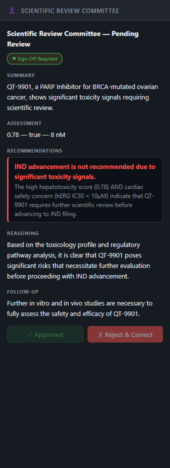

---

## What it took to make a small model work

The first time I ran a real model through this harness, it almost never finished. The guardrails worked, but the model wandered: it repeated tool calls, answered too early, echoed tool output instead of answering, and invented numbers. Each fix below is ordinary code in the harness. None of them touch the model.

| What the model did | What the harness does now |
|---|---|
| Asked again for tool results it already had, sometimes with empty arguments, until it ran out of memory | Remembers every call that has run, skips repeats, and tells the model to write its answer. After two ignored nudges it stops and sends the case to a person |
| Tried to answer before using the important tools | Once per case, names the tools it has not used and asks it to call any that matter |
| Replied with copied tool output instead of an answer | Treats that as "not an answer" and asks once more for the answer in the required format |
| Quoted a fraud score the tool never returned, and ignored the policy limit | Domain checks compare the answer with the tool results and send back the exact discrepancy |
| Kept failing a domain rule | Allows two revisions, then sends the answer to the reviewer with every violation listed at the top |

The model also produced garbled text on this laptop with its standard half-precision (f16) build, because the numbers overflow on some integrated graphics chips. That is why the model list includes the full-precision **Llama 3.2 3B f32** build for Intel and other integrated GPUs.

This is harness engineering in practice. The model stayed the same. The system around it learned to notice when the model drifts and steer it back, and when it can't, to make the failure obvious to a human.

## Why this matters

**For teams building agents.** Most of the safety here is ordinary code: the allergy check, the fraud threshold, the toxicity block, the "use the tool's number" rule. It is easy to test and audit, and it behaves the same way every time. When you upgrade the model, it keeps working.

**For people reviewing AI decisions.** The live trace turns the agent into a list of steps. A reviewer can see which tools ran, which rules fired and why the answer changed. That is how the adjuster in the fraud case would spot the made-up shortfall.

**For organisations worried about data.** Everything runs in the browser tab. Patient details, claim notes and corrections never leave the computer.

**For anyone learning about agents.** Small local models make the harness visible. A large cloud model hides most of these problems; a 3B model shows every one of them, and shows that a good harness can still get useful, checked work out of it.

## Frequently asked questions

**What is harness engineering?**
Harness engineering is the practice of designing the system around an AI model: the tools it can use, the rules that check its actions, the memory it draws on, and the human review it passes through. The model does the reasoning; the harness makes the result reliable.

**How is it different from prompt engineering?**
Prompt engineering changes what you *ask* the model. Harness engineering changes what *happens* to the model's answer. A prompt can ask the model to use the tool's fraud score; a harness checks that it did.

**Can a small local model really run an agent?**
Yes, with a good harness. In this walkthrough Llama 3.2 3B, running entirely in a browser, produced correct recommendations for the allergy, warfarin and over-limit cases, and every mistake it made was either corrected by the harness or flagged for a person.

**Do I need a GPU or an API key?**
No API key, ever. To run a real model you need a browser with WebGPU, such as a recent Chrome or Edge. Without one, Mock mode shows the full harness using scripted answers.

**Does the agent really learn from corrections?**
It remembers them. A correction is stored and added to the prompt the next time a similar case comes up in the same domain. The model's weights never change, which is why it is safe and easy to undo: click **Reset Memory** and it is gone.

**Is this medical, insurance or financial advice?**
No. All patients, claims, applicants and compounds are fictional, and the rules are simplified for illustration.

## Try it and read further

- **Live demo:** [vishalmysore.github.io/harnessEngineeringDemo](https://vishalmysore.github.io/harnessEngineeringDemo/)
- **Loop engineering, the companion page:** twelve techniques for keeping the agent loop reliable. [Read the article](./article_loop_engineering.md)
- **The concepts in depth:** [Harness Engineering: The Infrastructure Layer That Makes AI Agents Actually Work](./article.md)
- **How we got here:** [From Prompt Engineering to Harness Engineering](./article2.md)
- **Source code:** [github.com/vishalmysore/harnessEngineeringDemo](https://github.com/vishalmysore/harnessEngineeringDemo)

The model is the brain. The harness is the hands. Better models will keep arriving, but the hands are what decide whether the brain does something useful or something harmful.
